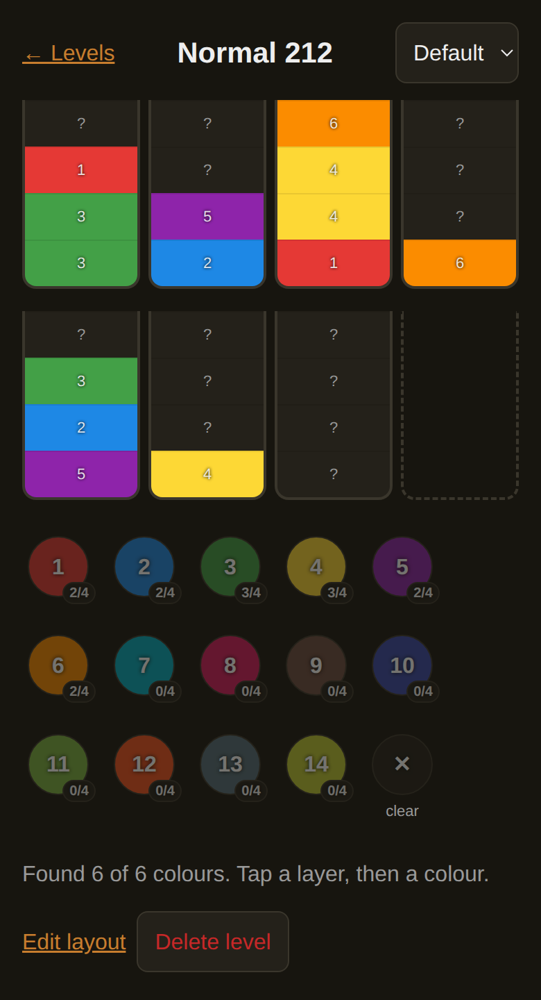

# Sand Tracker

A phone-first web app that remembers hidden colours in blind sand-sort levels.

In a blind level, each layer's colour stays hidden until the one above it is
poured off, and restarting the level forgets everything you'd uncovered. Sand
Tracker keeps what you've revealed, per level, across restarts and devices:
tap a layer, tap its colour, and it's saved.



- Per-level jar layouts with any capacity per jar, including jars that start empty
- Colour counts per swatch (`3/4`) and "found 6 of 6 colours" once every colour is seen
- Swappable palettes with optional colour names. Levels store colour IDs, not
  hex values, so changing a palette reskins every saved level
- Autosave with a debounced, retrying queue: works through a flaky connection
  and catches up when it's back
- Normal and special levels numbered separately

## How it's built

No dependencies: plain Node (≥ 22.5, using its built-in SQLite) and plain
browser JavaScript modules, no framework or build step.

| | |
|---|---|
| `shared/` | Level and palette rules (validation, resizing, colour counts) as pure functions, used by both server and browser |
| `server/` | HTTP server: a small JSON API over SQLite, plus the static files |
| `public/` | The single-page client: router, views, and the save queue |
| `test/` | 48 tests with `node:test` |

### How this was built

The app was built AI-first, with a paper trail:

1. A written [design spec](docs/spec.md): scope in and out, the data model, and
   validation rules shared by client and server.
2. An [implementation plan](docs/superpowers/plans/2026-10-02-sand-tracker.md)
   splitting the work into 10 tasks, each with the interfaces it consumes and
   produces. Those were checked against each other before building.
3. Each task built by an agent, tested, and committed before the next. Judgment
   calls were logged as rulings, each with a "cost if wrong".
4. A final review by a fresh agent with no context from the build. All five
   important findings were fixed. The two logic bugs got tests that failed
   before the fix and pass after; the rest were checked in a headless browser or
   by the save-queue tests. The six minor ones were written down and
   deliberately deferred.

The [build log](docs/build-log.md) has all of it: the interface checks, every
ruling, and each review finding with how it was fixed.

## Run locally

```sh
npm test
npm start            # http://localhost:8787
```

## Deploy (Debian/Ubuntu + nginx)

Runs as a systemd service bound to localhost, behind nginx with basic auth and
a certbot TLS certificate. The service file uses a private Node 22 in
`/opt/sand-tracker/node/`, so it doesn't depend on (or break) the system Node.
The rsync commands below exclude it.

```sh
sudo useradd --system --no-create-home sandtracker
sudo rsync -a --exclude data --exclude .git --exclude .superpowers --exclude node ./ /opt/sand-tracker/

# Private Node 22 (use linux-arm64 on ARM; needs xz-utils)
NODE=v22.23.4
sudo mkdir -p /opt/sand-tracker/node
curl -fsSL https://nodejs.org/dist/$NODE/node-$NODE-linux-x64.tar.xz | sudo tar -xJ --strip-components=1 -C /opt/sand-tracker/node

sudo cp deploy/sand-tracker.service /etc/systemd/system/
sudo systemctl daemon-reload && sudo systemctl enable --now sand-tracker
curl -s localhost:8787/api/palettes          # sanity check

sudo htpasswd -c /etc/nginx/sand-tracker.htpasswd <user>   # apache2-utils
sudo cp deploy/nginx.conf.example /etc/nginx/sites-available/sand-tracker
# edit server_name, then:
sudo ln -s /etc/nginx/sites-available/sand-tracker /etc/nginx/sites-enabled/
sudo nginx -t && sudo systemctl reload nginx
sudo certbot --nginx -d sand.<your-domain>
```

Data lives in `/var/lib/sand-tracker/sand.db`. Back it up by copying that file.

To update:

```sh
sudo rsync -a --exclude data --exclude .git --exclude .superpowers --exclude node ./ /opt/sand-tracker/
sudo systemctl restart sand-tracker
```

## License

[MIT](LICENSE)
